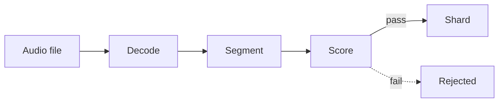

# AeroSieve

[](https://github.com/kunalgoesbyken/AeroSieve/actions/workflows/ci.yml)
[](https://crates.io/crates/aerosieve)
[](https://docs.rs/aerosieve)

**[Try it in your browser →](https://aerosieve.vercel.app)** The demo runs this Rust code compiled to WebAssembly, so your audio never leaves the page.

AeroSieve turns raw audio recordings into training data for speech models. It decodes each file, cuts it into speech clips, drops the clips that are silent, noisy, clipped, or not speech, and writes the rest as [WebDataset](https://github.com/webdataset/webdataset) shards. Every clip it drops comes with a reason.

It is written in Rust, runs on CPU with no ML model by default, and can be used as a command-line tool, a Rust library, from Python, in a browser, or as a [streaming WebSocket service](#streaming) that judges live audio one utterance at a time.

## Results

[SieveBench](crates/aerosieve-sievebench) damages clean speech in known ways (white, pink and babble noise at six levels, overdrive, a phone line, near-silence, tones and hum) and runs every damaged copy through the same code as the CLI. Across 1,834 recordings in six languages, that is 51,352 damaged recordings:

| Language | Source | Audio | Untouched audio kept | Over a phone line | Defects caught |
| :--- | :--- | ---: | ---: | ---: | ---: |
| English | LibriSpeech dev-clean sample | 8 min | 100% | 100% | 99.4% |
| Hindi | FLEURS dev | 43 min | 84% | 89% | 100.0% |
| Tamil | FLEURS dev | 75 min | 84% | 86% | 99.8% |
| Bengali | FLEURS dev | 87 min | 86% | 87% | 99.9% |
| Telugu | FLEURS dev | 54 min | 96% | 99% | 100.0% |
| Marathi | FLEURS dev | 94 min | 99% | 100% | 100.0% |

- 24,385 of 24,409 clips that should be rejected were rejected, and 24,383 of those rejections named the injected defect. 105 damaged recordings never became a clip at all; they are reported separately and counted neither way.
- FLEURS is read speech recorded on volunteers' own devices, so some "untouched" clips really are noisy. Most of what Hindi, Tamil and Bengali lose is source audio already under the 10 dB floor; LibriSpeech, recorded for audiobooks, keeps every clean clip.
- On white and pink noise, the WADA-SNR estimate lands within about 1.3 dB of the injected level from 0 to 20 dB. Babble (other people talking) reads up to 2.7 dB cleaner than it is, because it looks like speech.

`crates/aerosieve-sievebench/scripts/run_all.sh` downloads the corpora and reproduces every number above. The reports are in [`site/data`](site/data).

### What the benchmark found in AeroSieve

- **Clipping hid behind loudness leveling.** A loud, clipped file was turned down 3 dB before scoring, so its flattened peaks sat near 0.7 and passed as clean. Clipping is now measured against the source's own full scale.
- **Speech was cut at every word gap.** A 100 ms pause ended a clip, so natural speech broke into fragments under the 3 s minimum and was dropped: 23 of 73 clean English recordings produced no clip at all. Pauses under 500 ms are now bridged. On the same 43 minutes of Hindi, kept speech went from 16.4 to 25.6 minutes (+56%).

## Speed

43 minutes of Hindi as 48 kHz FLAC is decoded, resampled, segmented, scored and sharded in 2.75 s on 8 threads, about 940 times faster than real time (8.1 s on one thread, most of it decoding and resampling). As 16 kHz WAV it takes 0.55 s. Files are inspected in parallel and written in input order, so the shards are identical to a single-threaded run.

Run `cargo bench --bench pipeline_benchmark` to measure on your machine.

## How it works



| Step | What happens | Crate |
| :--- | :--- | :--- |
| Decode | Read wav, mp3, flac, ogg, or mp4. Convert to 16 kHz mono and even out the loudness. | [`aerosieve-decode`](crates/aerosieve-decode) |
| Segment | Find where speech starts and stops, and cut clips of 3 to 30 seconds. | [`aerosieve-segment`](crates/aerosieve-segment) |
| Score | Measure each clip's noise, loudness, clipping, and tonality, and compare against thresholds. | [`aerosieve-acoustic`](crates/aerosieve-acoustic) |
| Shard | Write accepted clips into tar files, with a manifest listing every clip. | [`aerosieve-shard`](crates/aerosieve-shard) |

[`aerosieve-lexical`](crates/aerosieve-lexical) cleans up transcripts using regex rules from a YAML file. [`aerosieve`](crates/aerosieve) connects everything into one `Pipeline`, [`aerosieve-cli`](crates/aerosieve-cli) is the command-line tool, and [`aerosieve-sievebench`](crates/aerosieve-sievebench) is the benchmark.

## Command line

```bash
cargo install aerosieve-cli
```

See how the filter judges your recordings, without writing anything:

```bash
aerosieve inspect recordings/
```

```
recordings/call-0412.wav (33.6 s, 8000 Hz source)
    START  LENGTH   SNR dB     dBFS   CLIP  FLATNESS  VERDICT
     0.0s   23.4s     20.4    -23.7  0.000     0.149  accept
    23.4s   10.2s     18.1    -26.0  0.000     0.182  accept
```

Curate a directory into shards:

```bash
aerosieve curate recordings/ --out data/run-1 --rules crates/aerosieve-lexical/rules/hinglish.yaml
```

This writes to `data/run-1`:

```
shard-000000.tar    clips, each stored as {key}.wav and {key}.json
manifest.jsonl      one line per clip: key, shard, transcript, metrics
stats.json          totals
```

- Directories are searched recursively for audio files.
- A transcript is read from a `.txt` file with the same name as the recording, if one exists.
- `--rules` is optional; without it transcripts are stored as given.
- `--policy thresholds.json` overrides filter thresholds, for example `{"min_snr_db": 15}`.
- Each run needs its own output directory. A directory that already holds a run is refused.
- `aerosieve nemo-manifest data/run-1` adds a manifest in the layout NVIDIA NeMo uses for tarred datasets.
- `curate` uses every core; set `RAYON_NUM_THREADS` to limit it.

## Python

```bash
pip install maturin
pip install ./bindings/python
```

```python
import aerosieve

for clip in aerosieve.inspect("recording.wav")["clips"]:
    print(clip["start_s"], clip["duration_s"], clip["verdict"])

stats = aerosieve.curate(["a.wav", "b.mp3"], "data/run-1", transcripts=["hello", None])
```

Details are in [`bindings/python`](bindings/python). A Gradio demo that draws the clips on the waveform is in [`demo`](demo).

## Rust

```rust
use aerosieve::{Pipeline, PipelineConfig};

fn main() -> Result<(), Box<dyn std::error::Error>> {
    let config = PipelineConfig::new("data/staging", "data/run-1")
        .with_rules("crates/aerosieve-lexical/rules/hinglish.yaml");

    let mut pipeline = Pipeline::new(config)?;
    pipeline.process_file("recording.wav".as_ref(), Some("yeh ₹500 hai"))?;

    let stats = pipeline.finish()?;
    println!("kept {:.1}% of detected speech", stats.retention_rate() * 100.0);
    Ok(())
}
```

`Pipeline::process_files` curates many files on every core with the same result as calling `process_file` on each in order.

## Streaming

[`aerosieve-serve`](crates/aerosieve-serve) judges live audio, such as a call or a voice agent's microphone, over a WebSocket. Each utterance's verdict comes back as soon as the pause that ends it is heard, and it is the verdict batch curation would reach on the same audio: the batch segmenter is the streaming one fed the whole file, and tests stream audio in random chunk sizes and check that the clips and scores are identical.

```sh
cargo run --release -p aerosieve-serve
python crates/aerosieve-serve/clients/stream_wav.py recording.wav
```

On a 4-core laptop it holds 1,000 concurrent live streams with verdicts arriving 14.8 ms (p95) after the frame that completed the clip, with the load generator on the same machine. Memory per stream is bounded by the utterance in progress. Protocol, limits, metrics and the full latency table are in [`crates/aerosieve-serve`](crates/aerosieve-serve).

## Browser

[`bindings/wasm`](bindings/wasm) compiles the decode, segment and score path to WebAssembly. [`site`](site) is the landing page and live demo built on it; see [`site/README.md`](site/README.md) to build and run it locally.

## What gets rejected

Synthetic signals, from `cargo run --release --example report`:

| Input | SNR | Level | Flatness | Result |
| :--- | ---: | ---: | ---: | :--- |
| clean speech | 14.7 dB | −22.4 dBFS | 0.192 | accepted |
| silence | −∞ | −∞ | 1.000 | `silence` |
| very quiet speech | 14.7 dB | −56.4 dBFS | 0.192 | `too_quiet` |
| clipped speech | 13.8 dB | −7.4 dBFS | 0.210 | `clipping` |
| pure tone | −20.0 dB | −9.0 dBFS | 0.000 | `tonal` |
| white noise | −14.9 dB | −20.0 dBFS | 0.562 | `low_snr` |

- **SNR** is estimated with [WADA-SNR](https://www.isca-archive.org/interspeech_2008/kim08e_interspeech.html), which needs only the clip itself and no clean reference.
- **Flatness** separates tones and hum (near 0) from speech and noise. It is measured between 300 and 3400 Hz so that resampled audio is not mistaken for a tone.

Every threshold is a field of `FilterPolicy`.

## Silero VAD

By default speech is detected from signal level, so loud music counts as speech and long pauses in a noisy recording may not split a clip. For a real speech detector, build with `--features silero` and pass a `SileroDetector` to `Pipeline::with_detector`. Setup is described in [`aerosieve-segment`](crates/aerosieve-segment#silerodetector-feature-silero). The command-line tool does not expose this yet.

## Limitations

- SieveBench's defects are injected, so it shows that the filters catch damage of known kinds and levels. It does not show that rejected real-world audio would have hurt a model; that needs a training run.
- A single sustained instrument can pass as speech, and babble noise reads cleaner than it is.
- One transcript is given per file and copied to every clip from that file. Transcripts are not aligned to clips, and there is no speech recognition.
- Run `aerosieve inspect` on your own data before a large job; where to put the SNR floor is a real choice.

## License

MIT
