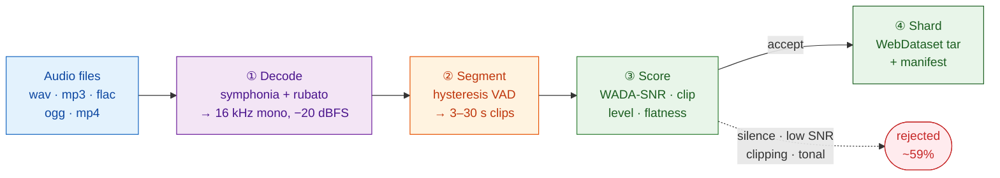

# AeroSieve

**A batch audio curation pipeline in Rust.** Raw audio in, model-ready training shards out.

Voice AI models are trained on millions of short audio + transcript pairs, and most of what gets scraped is unusable — clipped, noisy, silent, or music. AeroSieve decides what to keep. It decodes any common container, cuts speech into training-length clips with a VAD state machine, scores every clip with deterministic DSP, and writes what survives as [WebDataset](https://github.com/webdataset/webdataset) shards.

> This repo is a demonstration of systems engineering, not a product. Every number below is reproduced by the command that prints it, and every claim has code behind it.

---

## Architecture

The stages follow [Emilia-Pipe](https://arxiv.org/abs/2407.05361) (arXiv 2407.05361), the reference pipeline behind a 101k-hour speech dataset.



| Stage | Crate | What it does |
| :--- | :--- | :--- |
| ① Decode | `aerosieve-decode` | symphonia demux/decode, rubato resample to 16 kHz mono, normalize to −20 dBFS with gain clamped ±3 dB |
| ② Segment | `aerosieve-segment` | Hysteresis state machine emitting variable-length clips; pluggable `SpeechDetector` |
| ③ Score | `aerosieve-acoustic` | WADA-SNR, clip ratio, level, spectral flatness, filtered by an explicit policy |
| ④ Shard | `aerosieve-shard` | WebDataset tar shards, atomic commit, manifest + stats |
| — | `aerosieve-lexical` | Single-pass leftmost-longest transcript normalization |

**Rejection is the product.** Emilia-Pipe retains ~29.4% of in-the-wild audio. A curation pipeline that keeps everything isn't filtering.

---

## What the filter actually does

Printed by `cargo bench --bench pipeline_benchmark`:

| Input | WADA-SNR | Level | Flatness | Verdict |
| :--- | ---: | ---: | ---: | :--- |
| clean speech | 14.7 dB | −22.4 dBFS | 0.034 | **accept** |
| digital silence | −∞ | −∞ | 1.000 | silence |
| quiet speech | 14.7 dB | −56.4 dBFS | 0.034 | too_quiet |
| clipped speech | 13.8 dB | −7.4 dBFS | 0.035 | clipping |
| pure tone | −20.0 dB | −9.0 dBFS | 0.000 | tonal |
| white noise | −20.0 dB | −18.7 dBFS | 0.561 | low_snr |

Each degradation is caught by the metric meant to catch it, and clean speech passes.

### Why WADA-SNR

The obvious approach — compare a frame's energy to a noise floor — needs a reference or a separate noise estimate, and gets it wrong when neither exists. [WADA-SNR](https://www.isca-archive.org/interspeech_2008/kim08e_interspeech.html) (Kim & Stern, Interspeech 2008) instead models clean speech as Gamma(0.4) and additive noise as Gaussian, then estimates SNR from the amplitude distribution of a single buffer with no reference at all. It shows less bias and less variance across noise types than NIST STNR.

One consequence is worth knowing: a **pure sine reads as −20 dB**, because its bimodal arcsine amplitude distribution is nothing like Gamma(0.4). That is correct behaviour — synthetic tones are not speech — but it means test fixtures must be speech-*like* in their amplitude statistics (a glottal pulse train), not merely a sum of harmonics.

---

## Performance

Measured with `cargo bench --bench pipeline_benchmark` on a Windows laptop, release build, single thread. Your numbers will differ; the command prints its own.

### End-to-end

| Metric | Value |
| :--- | ---: |
| Audio curated | **11.0 hours per minute** of wall clock |
| 10 min corpus | 912 ms |
| Segments found → accepted | 92 → 38 |
| **Retention (by duration)** | **41.3%** |

The benchmark corpus is deliberately mixed — two runs in five are usable speech, the rest clipped, tonal, or noisy — so retention measures something. Rejections split 18 Clipping / 18 LowSnr / 18 Tonal, matching what was planted.

For scale, Emilia-Pipe reports 2.5 raw hours/minute on 8× RTX 4090, though it also runs source separation, diarization, and ASR, which AeroSieve does not.

### Per stage

| Stage | Operation | Time |
| :--- | :--- | ---: |
| Segment | 1 minute of audio | ~2.0 ms |
| Score | 5 s clip (all metrics) | ~7.1 ms |
| └ WADA-SNR | 5 s clip | ~2.2 ms |
| └ Spectral flatness | 5 s clip | ~3.3 ms |
| Normalize | Hinglish sentence | ~9.6 µs |
| Normalize | no-match string | ~4.8 µs |
| Shard | write + commit one clip | ~7.7 ms |

Sharding is disk-bound and dominates; everything upstream is compute.

### Python baseline

A naive Python implementation of the same gating lives in [`baselines/python_naive.py`](./baselines/python_naive.py).

Measured across four runs on the same machine: **5,457 / 7,019 / 8,333 / 10,861 fps** — a 2× spread depending on CPU frequency state. Treat it as **~5–11k fps**, not a single figure. Run it yourself:

```bash
python baselines/python_naive.py
```

The honest comparison is that AeroSieve does strictly more work per clip (real SNR estimation, spectral analysis, WebDataset encoding) at a throughput where a 10-minute corpus curates in under a second. Quoting a single speedup multiple from one unrepeated measurement is how the previous version of this README ended up overstating its numbers by 1.8–4.1×.

---

## Quickstart

```bash
cargo build --release
cargo test --workspace          # 144 tests (152 with --features silero on MSVC)
cargo run --release --example basic
cargo bench --bench pipeline_benchmark
```

The example prints:

```text
Segments found: 1
  [0] 6.11s  snr   14.7 dB  level  -22.5 dBFS  flatness 0.034  -> accepted

Accepted 1/1 segments, retention 100.0% of speech duration
Wrote 1 sample(s) across 1 shard(s) to data/clean
```

### Usage

```rust
use aerosieve::{Pipeline, PipelineConfig};

fn main() -> Result<(), Box<dyn std::error::Error>> {
    let config = PipelineConfig::new("data/staging", "data/clean")
        .with_rules("crates/aerosieve-lexical/rules/default.yaml");

    let mut pipeline = Pipeline::new(config)?;
    pipeline.process_file("recording.wav".as_ref(), Some("yeh ₹500 hai"))?;

    let stats = pipeline.finish()?;
    println!("retention {:.1}%", stats.retention_rate() * 100.0);
    Ok(())
}
```

Output lands in `data/clean` as `shard-000000.tar` (paired `{key}.wav` + `{key}.json`), plus `manifest.jsonl` and `stats.json`.

---

## Design decisions

**Deterministic DSP by default, ML opt-in.** The default build has no ONNX dependency and runs on any toolchain. Silero VAD ([87% accuracy on noisy audio vs. WebRTC's 58%](https://github.com/Anwarvic/VAD_Benchmark)) is available behind `--features silero`, which requires an MSVC toolchain on Windows because `ort` ships no prebuilt ONNX Runtime for `windows-gnu`:

```bash
curl -sL -o models/silero_vad.onnx \
  https://raw.githubusercontent.com/snakers4/silero-vad/master/src/silero_vad/data/silero_vad.onnx
cargo +stable-x86_64-pc-windows-msvc test -p aerosieve-segment --features silero
```

Worth knowing before you reach for it: Silero is trained on real speech and scores *synthetic* audio at ~0.001 regardless of what you feed it — DC, white noise, a 200 Hz sine, and a synthetic vowel all come back as "not speech". That is correct behaviour, but it means the synthetic fixtures this repo tests with are useless for exercising it. The live tests therefore assert what is verifiable without a real recording: that probabilities vary with input, and that the recurrent state is genuinely threaded between calls.

**Segments, not frames.** Real VAD is a hysteresis state machine — separate enter (0.5) and exit (0.35) thresholds, `min_speech_duration_ms` 250, `min_silence_duration_ms` 100, `speech_pad_ms` 30 — emitting variable-length clips. These are Silero's documented defaults. A per-frame boolean can't express "a 40 ms dip mid-word is not the end of an utterance."

**Single-pass normalization.** Rules match against the original text only, resolved leftmost-longest over disjoint spans. Chained `replace_all` lets rule *N* rewrite rule *N−1*'s output, so a rule mapping `dr → doctor` followed by `doctor → PHYSICIAN` yields `PHYSICIAN`. [NeMo's ITN work](https://arxiv.org/abs/2104.05055) uses WFST grammars for exactly this reason.

**Sharded output.** Per-sample files mean millions of tiny random reads at training time. WebDataset shards are sequential and stream from object storage.

**Errors are loud.** A missing rules file fails at construction. Silently continuing with no rules would disable normalization for an entire corpus behind one warning line.

---

## Scope

**Implemented:** file ingestion (wav, mp3, flac, ogg, mp4, aac), resampling, loudness normalization, VAD segmentation, quality scoring and filtering, transcript normalization, WebDataset output with atomic commit.

**Optional:** Silero VAD behind `--features silero`. Compiled and tested against the real model on the MSVC toolchain — 8 live inference tests covering model loading, sample-rate validation, probability bounds, input sensitivity, recurrent-state threading, and reset semantics. Not built by default.

**Not implemented**, and not claimed: source separation, speaker diarization, ASR (transcripts are accepted, not generated), real-time streaming, microphone and TCP sources, GPU execution.

Design notes and the research behind these choices are in [`docs/superpowers/`](./docs/superpowers/).

---

## License

MIT
