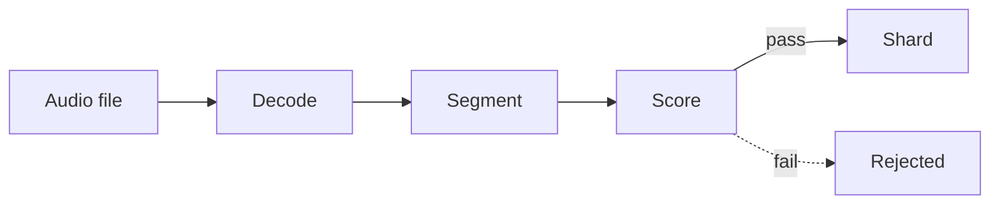

# AeroSieve

AeroSieve turns raw audio recordings into training data for speech models. It decodes each file, cuts it into speech clips, drops the clips that are silent, noisy, clipped, or not speech, and writes the rest as [WebDataset](https://github.com/webdataset/webdataset) shards.

It is written in Rust, runs on CPU with no ML model by default, and can be used as a command-line tool, a Rust library, or from Python.

## How it works



| Step | What happens | Crate |
| :--- | :--- | :--- |
| Decode | Read wav, mp3, flac, ogg, or mp4. Convert to 16 kHz mono and even out the loudness. | [`aerosieve-decode`](crates/aerosieve-decode) |
| Segment | Find where speech starts and stops, and cut clips of 3 to 30 seconds. | [`aerosieve-segment`](crates/aerosieve-segment) |
| Score | Measure each clip's noise, loudness, clipping, and tonality, and compare against thresholds. | [`aerosieve-acoustic`](crates/aerosieve-acoustic) |
| Shard | Write accepted clips into tar files, with a manifest listing every clip. | [`aerosieve-shard`](crates/aerosieve-shard) |

[`aerosieve-lexical`](crates/aerosieve-lexical) cleans up transcripts using regex rules from a YAML file. [`aerosieve`](crates/aerosieve) connects everything into one `Pipeline`, and [`aerosieve-cli`](crates/aerosieve-cli) is the command-line tool.

## Command line

```bash
cargo install --path crates/aerosieve-cli
```

See how the filter judges your recordings, without writing anything:

```bash
aerosieve inspect recordings/
```

```
recordings/call-0412.wav (33.6 s, 8000 Hz source)
    START  LENGTH   SNR dB     dBFS   CLIP  FLATNESS  VERDICT
     0.0s   23.4s     20.4    -23.7  0.000     0.149  accept
    23.4s   10.2s     18.1    -26.0  0.000     0.182  accept
```

Curate a directory into shards:

```bash
aerosieve curate recordings/ --out data/run-1 --rules crates/aerosieve-lexical/rules/hinglish.yaml
```

This writes to `data/run-1`:

```
shard-000000.tar    clips, each stored as {key}.wav and {key}.json
manifest.jsonl      one line per clip: key, shard, transcript, metrics
stats.json          totals
```

- Directories are searched recursively for audio files.
- A transcript is read from a `.txt` file with the same name as the recording, if one exists.
- `--rules` is optional; without it transcripts are stored as given.
- `--policy thresholds.json` overrides filter thresholds, for example `{"min_snr_db": 15}`.
- Each run needs its own output directory. A directory that already holds a run is refused.
- `aerosieve nemo-manifest data/run-1` adds a manifest in the layout NVIDIA NeMo uses for tarred datasets.

## Python

```bash
pip install maturin
pip install ./bindings/python
```

```python
import aerosieve

for clip in aerosieve.inspect("recording.wav")["clips"]:
    print(clip["start_s"], clip["duration_s"], clip["verdict"])

stats = aerosieve.curate(["a.wav", "b.mp3"], "data/run-1", transcripts=["hello", None])
```

Details are in [`bindings/python`](bindings/python). A small web demo that draws the clips on the waveform is in [`demo`](demo).

## Rust

```rust
use aerosieve::{Pipeline, PipelineConfig};

fn main() -> Result<(), Box<dyn std::error::Error>> {
    let config = PipelineConfig::new("data/staging", "data/run-1")
        .with_rules("crates/aerosieve-lexical/rules/hinglish.yaml");

    let mut pipeline = Pipeline::new(config)?;
    pipeline.process_file("recording.wav".as_ref(), Some("yeh ₹500 hai"))?;

    let stats = pipeline.finish()?;
    println!("kept {:.1}% of detected speech", stats.retention_rate() * 100.0);
    Ok(())
}
```

## What gets rejected

Synthetic signals, from `cargo run --release --example report`:

| Input | SNR | Level | Flatness | Result |
| :--- | ---: | ---: | ---: | :--- |
| clean speech | 14.7 dB | −22.4 dBFS | 0.192 | accepted |
| silence | −∞ | −∞ | 1.000 | `silence` |
| very quiet speech | 14.7 dB | −56.4 dBFS | 0.192 | `too_quiet` |
| clipped speech | 13.8 dB | −7.4 dBFS | 0.210 | `clipping` |
| pure tone | −20.0 dB | −9.0 dBFS | 0.000 | `tonal` |
| white noise | −14.9 dB | −20.0 dBFS | 0.562 | `low_snr` |

- **SNR** is estimated with [WADA-SNR](https://www.isca-archive.org/interspeech_2008/kim08e_interspeech.html), which needs only the clip itself and no clean reference.
- **Flatness** separates tones and hum (near 0) from speech and noise. It is measured between 300 and 3400 Hz so that resampled audio is not mistaken for a tone.

Every threshold is a field of `FilterPolicy`.

## Results on real recordings

These runs use the default thresholds. None of the audio is stored in this repository.

**Indian-language speech.** The dev split of [FLEURS](https://huggingface.co/datasets/google/fleurs), which is read speech recorded by volunteers on their own devices. The last column passes the same audio through a simulated phone line (8 kHz, G.711 μ-law) first.

| Language | Audio | Clips | Accepted | Accepted over a phone line |
| :--- | ---: | ---: | ---: | ---: |
| Hindi | 43 min | 213 | 59% | 62% |
| Tamil | 75 min | 366 | 71% | 72% |
| Bengali | 87 min | 445 | 83% | 83% |
| Telugu | 54 min | 337 | 63% | 62% |
| Marathi | 94 min | 305 | 87% | 83% |

Almost every rejection is `low_snr`. The median clip reads between 11 and 18 dB depending on the language, so the default floor of 10 dB sits inside the bulk of this data, and where to put it is a real choice. FLEURS has no noise labels, so these numbers show what the filter does, not whether each rejection is correct.

**Known noise levels.** Clean speech in English, German, Spanish, and Russian, with noise added at a set level:

| Noise added at | 20 dB | 15 dB | 10 dB | 5 dB |
| :--- | ---: | ---: | ---: | ---: |
| Clips accepted (of 30) | 30 | 23 | 4 | 0 |

**Music.** 13 of 14 clips from four music tracks were rejected, mostly by the SNR check. The one that passed was a solo trumpet.

## Speed

On one laptop core, `aerosieve curate` turned the 43 minutes of Hindi audio above (239 files) into shards in 1.7 seconds, including decoding.

| Operation | Time |
| :--- | ---: |
| Segment 1 minute of audio | 1.2 ms |
| Score a 5-second clip | 3.2 ms |
| Clean up one transcript | 10 µs |
| Write a 5-second clip to a shard | 8.3 ms |

Run `cargo bench --bench pipeline_benchmark` to measure on your machine.

## Silero VAD

By default speech is detected from signal level, so loud music counts as speech and long pauses in a noisy recording may not split a clip. For a real speech detector, build with `--features silero` and pass a `SileroDetector` to `Pipeline::with_detector`. Setup is described in [`aerosieve-segment`](crates/aerosieve-segment#silerodetector-feature-silero). The command-line tool does not expose this yet.

## Limitations

- The default thresholds have only been checked on the recordings above. Run `aerosieve inspect` on your own data before a large job.
- A single sustained instrument can pass as speech.
- One transcript is given per file and copied to every clip from that file. Transcripts are not aligned to clips, and there is no speech recognition.
- Files are processed one at a time on a single thread.

## License

MIT
