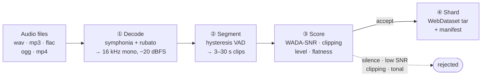

# AeroSieve

**A batch audio curation pipeline in Rust.** Raw audio in, model-ready training shards out.

Speech models are trained on millions of short audio and transcript pairs, and most scraped audio is unusable: clipped, noisy, silent, or music. AeroSieve decides what to keep. It decodes any common container, cuts speech into training-length clips with a VAD state machine, scores every clip with deterministic DSP, and writes what survives as [WebDataset](https://github.com/webdataset/webdataset) shards.

This repository is a systems-engineering demonstration, not a product. Its filter thresholds are calibrated on synthetic audio (see [Limitations](#limitations)).

## Architecture

The stages follow [Emilia-Pipe](https://arxiv.org/abs/2407.05361), the pipeline behind a 101k-hour speech dataset.



| Stage | Crate | What it does |
| :--- | :--- | :--- |
| ① Decode | [`aerosieve-decode`](crates/aerosieve-decode) | symphonia demux and decode, downmix, rubato resample, RMS normalization with clamped gain |
| ② Segment | [`aerosieve-segment`](crates/aerosieve-segment) | Hysteresis state machine emitting variable-length clips; pluggable `SpeechDetector` |
| ③ Score | [`aerosieve-acoustic`](crates/aerosieve-acoustic) | WADA-SNR, clip ratio, level, and spectral flatness, judged by a tunable `FilterPolicy` |
| ④ Shard | [`aerosieve-shard`](crates/aerosieve-shard) | WebDataset tar shards with atomic commit, manifest, and stats |
| — | [`aerosieve-lexical`](crates/aerosieve-lexical) | Single-pass transcript normalization driven by YAML rules |
| — | [`aerosieve`](crates/aerosieve) | The `Pipeline` that wires the stages together |

`aerosieve-fixtures` holds the deterministic synthetic audio shared by tests, benches, and examples.

## Quickstart

```bash
cargo test --workspace
cargo run --release --example basic     # curate one synthetic recording into data/clean
cargo run --release --example report    # what the default filter keeps, and how fast
cargo bench --bench pipeline_benchmark  # per-stage cost
```

### Usage

```rust
use aerosieve::{Pipeline, PipelineConfig};

fn main() -> Result<(), Box<dyn std::error::Error>> {
    let config = PipelineConfig::new("data/staging", "data/clean")
        .with_rules("crates/aerosieve-lexical/rules/hinglish.yaml");

    let mut pipeline = Pipeline::new(config)?;
    pipeline.process_file("recording.wav".as_ref(), Some("yeh ₹500 hai"))?;

    let stats = pipeline.finish()?;
    println!("retention {:.1}%", stats.retention_rate() * 100.0);
    Ok(())
}
```

Output lands in `data/clean` as `shard-000000.tar` (paired `{key}.wav` and `{key}.json` members), plus `manifest.jsonl` and `stats.json`.

`Pipeline::new` detects speech by signal level. To use another detector, such as Silero VAD, pass it to `Pipeline::with_detector`.

## What the filter does

Printed by `cargo run --release --example report`:

| Input | WADA-SNR | Level | Flatness | Verdict |
| :--- | ---: | ---: | ---: | :--- |
| clean speech | 14.7 dB | −22.4 dBFS | 0.192 | **accept** |
| digital silence | −∞ | −∞ | 1.000 | silence |
| quiet speech | 14.7 dB | −56.4 dBFS | 0.192 | too_quiet |
| clipped speech | 13.8 dB | −7.4 dBFS | 0.210 | clipping |
| pure tone | −20.0 dB | −9.0 dBFS | 0.000 | tonal |
| white noise | −14.9 dB | −20.0 dBFS | 0.562 | low_snr |

Every threshold is a field of `FilterPolicy`.

**WADA-SNR** ([Kim & Stern, Interspeech 2008](https://www.isca-archive.org/interspeech_2008/kim08e_interspeech.html)) estimates SNR from the amplitude distribution of a single buffer, with no clean reference and no separate noise estimate. It models clean speech as Gamma(0.4) and noise as Gaussian, so anything that is not speech-like, including a noiseless sine, reads as low SNR.

**Spectral flatness** is measured over the 300–3400 Hz speech band rather than the whole spectrum. A resampler's low-pass empties the bins near Nyquist, and upsampled telephone audio has nothing above 4 kHz; over the full spectrum either one makes speech read as a tone.

## Performance

Measured on one Windows laptop, release build, single thread. The same report run curates a 10-minute synthetic corpus in which two runs in five are usable speech and the rest are clipped, tonal, or noisy:

| Metric | Value |
| :--- | ---: |
| Wall clock for 10 minutes of audio | ~340 ms |
| Segments found → accepted | 92 → 38 |
| Retention of detected speech, by duration | 41.3% |
| Rejections | 18 clipping · 18 tonal · 18 low_snr |

That run starts from decoded samples, so it excludes decoding and resampling.

| Stage | Operation | Time |
| :--- | :--- | ---: |
| Segment | 1 minute of audio | ~1.2 ms |
| Score | 5 s clip, all metrics | ~3.2 ms |
| Normalize | one Hinglish sentence | ~10 µs |
| Shard | write and commit one 5 s clip | ~8.3 ms |

Sharding is bound by the disk; everything upstream is compute.

## Design decisions

**Deterministic DSP by default, ML opt-in.** The default build has no ONNX dependency. Silero VAD is available behind `--features silero`; see [`aerosieve-segment`](crates/aerosieve-segment) for toolchain requirements.

**Segments, not frames.** A per-frame speech flag cannot express "a 40 ms dip mid-word is not the end of an utterance". The segmenter uses separate enter and exit thresholds and a minimum silence duration, with Silero's documented defaults.

**Single-pass normalization.** Chained `replace_all` lets one rule rewrite another's output: `dr → doctor` followed by `doctor → PHYSICIAN` yields `PHYSICIAN`. Here every rule matches the original text and overlaps are resolved leftmost-longest.

**Sharded output.** Per-sample files mean millions of small random reads at training time. Shards are read sequentially and stream from object storage.

**Errors are loud.** A missing rules file, a misspelled rule field, a failed inference, or stages configured for different sample rates stop the run instead of degrading it silently.

## Limitations

- The default `FilterPolicy` is calibrated on synthetic speech-like signals, not on a labelled corpus of real recordings. Validate it on your own data before trusting its retention figures.
- One transcript is supplied per file and attached to every clip cut from it. Transcripts are not aligned to clips, and AeroSieve does not run ASR.
- Shard and manifest names are deterministic, so writing into an output directory that already holds a run replaces that run's files.
- Files are processed one at a time on one thread.
- Not implemented: source separation, speaker diarization, streaming input, GPU execution.

## License

MIT
