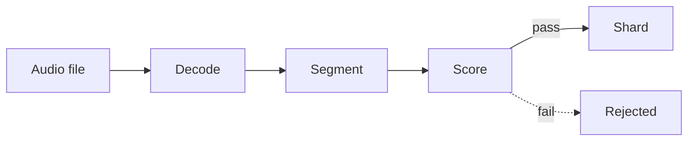

# AeroSieve

AeroSieve turns raw audio recordings into training data for speech models. It decodes each file, cuts it into speech clips, drops the clips that are silent, noisy, clipped, or not speech, and writes the rest as [WebDataset](https://github.com/webdataset/webdataset) shards.

It is written in Rust and runs on CPU with no ML model by default.

## How it works



| Step | What happens | Crate |
| :--- | :--- | :--- |
| Decode | Read wav, mp3, flac, ogg, or mp4. Convert to 16 kHz mono and even out the loudness. | [`aerosieve-decode`](crates/aerosieve-decode) |
| Segment | Find where speech starts and stops, and cut clips of 3 to 30 seconds. | [`aerosieve-segment`](crates/aerosieve-segment) |
| Score | Measure each clip's noise, loudness, clipping, and tonality, and compare against thresholds. | [`aerosieve-acoustic`](crates/aerosieve-acoustic) |
| Shard | Write accepted clips into tar files, with a manifest listing every clip. | [`aerosieve-shard`](crates/aerosieve-shard) |

Two more crates sit alongside these. [`aerosieve-lexical`](crates/aerosieve-lexical) cleans up transcripts using regex rules from a YAML file. [`aerosieve`](crates/aerosieve) connects everything into one `Pipeline`.

## Quickstart

```bash
cargo test --workspace
cargo run --release --example basic     # curate one synthetic recording into data/clean
cargo run --release --example report    # show what the filter keeps and how long it takes
cargo run --release --example inspect -- your.wav   # see how the filter judges your own audio
```

## Usage

```rust
use aerosieve::{Pipeline, PipelineConfig};

fn main() -> Result<(), Box<dyn std::error::Error>> {
    let config = PipelineConfig::new("data/staging", "data/clean")
        .with_rules("crates/aerosieve-lexical/rules/hinglish.yaml");

    let mut pipeline = Pipeline::new(config)?;
    pipeline.process_file("recording.wav".as_ref(), Some("yeh ₹500 hai"))?;

    let stats = pipeline.finish()?;
    println!("kept {:.1}% of detected speech", stats.retention_rate() * 100.0);
    Ok(())
}
```

This writes to `data/clean`:

```
shard-000000.tar    clips, each stored as {key}.wav and {key}.json
manifest.jsonl      one line per clip: key, shard, transcript, metrics
stats.json          totals
```

The transcript is optional. `with_rules` is optional too; without it transcripts are stored as given.

Each run needs its own output directory. The pipeline refuses to write into one that already holds a run.

## What gets rejected

Output of `cargo run --release --example report`:

| Input | SNR | Level | Flatness | Result |
| :--- | ---: | ---: | ---: | :--- |
| clean speech | 14.7 dB | −22.4 dBFS | 0.192 | accepted |
| silence | −∞ | −∞ | 1.000 | `silence` |
| very quiet speech | 14.7 dB | −56.4 dBFS | 0.192 | `too_quiet` |
| clipped speech | 13.8 dB | −7.4 dBFS | 0.210 | `clipping` |
| pure tone | −20.0 dB | −9.0 dBFS | 0.000 | `tonal` |
| white noise | −14.9 dB | −20.0 dBFS | 0.562 | `low_snr` |

- **SNR** is estimated with [WADA-SNR](https://www.isca-archive.org/interspeech_2008/kim08e_interspeech.html), which needs only the clip itself and no clean reference.
- **Flatness** separates tones and music (near 0) from speech and noise. It is measured between 300 and 3400 Hz so that resampled audio is not mistaken for a tone.

Every threshold is a field of `FilterPolicy` and can be changed with `PipelineConfig::with_policy`.

### Checked on real recordings

The table above uses synthetic signals. The defaults were also run on a small set of public recordings:

| Audio | Clips | Accepted |
| :--- | ---: | ---: |
| Clean speech in English, German, Spanish, and Russian, at 8 and 16 kHz | 31 | 31 |
| The same speech with noise added at 20 dB SNR | 30 | 30 |
| at 15 dB | 30 | 23 |
| at 10 dB | 30 | 4 |
| at 5 dB | 30 | 0 |
| Music (four tracks) | 14 | 1 |

The one music clip that passed was a solo trumpet. Music is rejected mostly by the SNR check, since its flatness overlaps with speech.

The speech came from the Silero VAD sample files, the Open Speech Repository, and the VOiCES corpus; the music from librosa's example audio. None of it is stored in this repository. This is a sanity check on a few minutes of audio, so run `inspect` on your own recordings before a large job.

## Speed

On one laptop core, a 10-minute test recording takes about 340 ms to segment, score, and shard. That figure starts from decoded samples, so decoding is not included.

| Operation | Time |
| :--- | ---: |
| Segment 1 minute of audio | 1.2 ms |
| Score a 5-second clip | 3.2 ms |
| Clean up one transcript | 10 µs |
| Write a 5-second clip to a shard | 8.3 ms |

Run `cargo bench --bench pipeline_benchmark` to measure on your machine.

## Silero VAD

By default speech is detected from signal level, so loud music counts as speech. For a real speech detector, build with `--features silero` and pass a `SileroDetector` to `Pipeline::with_detector`. Setup is described in [`aerosieve-segment`](crates/aerosieve-segment#silerodetector-feature-silero).

## Limitations

- The default thresholds have only been checked on the small set of recordings above.
- A single sustained instrument can pass as speech.
- One transcript is given per file and copied to every clip from that file. Transcripts are not aligned to clips, and there is no speech recognition.
- Files are processed one at a time on a single thread.

## License

MIT
